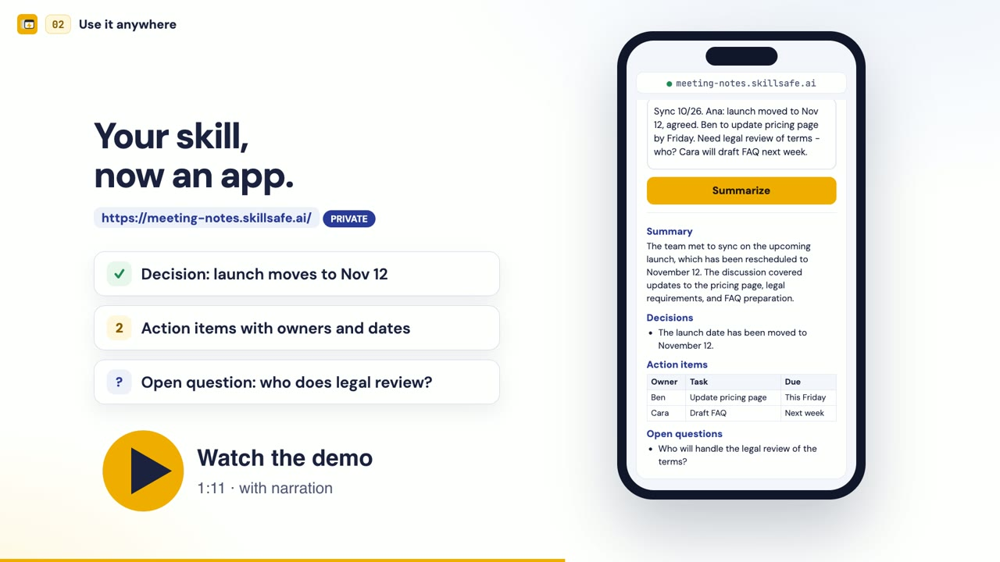

# SkillSafe plugin

Back up your agent skills privately, with version history, and restore them on
any machine. Turn them into hosted web apps for yourself or to share. Find and
security-check skills in the SkillSafe registry. Works in Codex and Gemini CLI.

[](https://www.youtube.com/watch?v=xMadt3TBTeQ)

## What you can ask for

- "Back up my skills to SkillSafe."
- "Restore my SkillSafe skills on this computer."
- "Show my backed-up skills and their versions."
- "Turn my skill into a private web app I can use from my phone."
- "Share my app with alice@example.com."
- "Find a SkillSafe skill for making slide decks."
- "Scan these skill files for prompt injection before I install them."

## Skills

| Skill | What it does |
|---|---|
| `skillsafe-sign-in` | Connects your SkillSafe account through a browser sign-in and stores the key on this machine. Signing up is free. No account yet? It can mint a temporary key so you can deploy an app right away; verify your email within 7 days to keep it. |
| `back-up-skills` | Saves your skills to your private account. Every backup is a new version; unchanged skills are skipped. Lists your backups, restores any version into a folder, and deletes a backup when you ask. |
| `deploy-app` | Turns your skills (or a prompt) into a web app at `https://your-app.skillsafe.ai/`: private for you, shared with specific people by email, open to anyone with the link, or listed publicly. |

### SkillSafe connector (MCP)

The plugin also connects your agent to the SkillSafe MCP server at
`https://api.skillsafe.ai/mcp`, which needs no sign-in:

| Tool | What it does |
|---|---|
| `search_skills` | Search the SkillSafe registry. |
| `recommend_skills` | Recommend skills for a task you describe. |
| `get_skill_info` | Show a skill's details, versions, and scan status. |
| `get_install_commands` | Give the commands to install a skill; installs nothing itself. |
| `scan_skill` | Scan skill files for prompt injection, credential theft, exfiltration, and other risks. |
| `scan_mcp_config` | Scan MCP tool definitions or server configs for poisoning patterns. |

## Install

**Codex**

```bash
codex plugin marketplace add skillsafe/skillsafe-plugin
codex plugin add skillsafe
```

**Gemini CLI**

```bash
gemini extensions install https://github.com/skillsafe/skillsafe-plugin
```

In Gemini CLI the extension adds the same three skills and the SkillSafe connector,
plus a short `GEMINI.md` that tells Gemini when to use them.

Then ask your agent to sign in to SkillSafe, or just ask for a backup and it
will sign you in first.

**No account?** Ask your agent to deploy an app anyway. It runs on a temporary
account and you get a live link immediately. The temporary account is deleted
after 7 days unless you verify your email; verifying keeps the app at the same
address, adds free starting credits for its AI features, and lets you make it
private or invite people. Your agent reminds you until you do.

## What the plugin sends, and where

The plugin contains instructions and one remote MCP server: no hooks, local
processes, or background tasks. When you use it, your agent makes HTTPS
requests to `api.skillsafe.ai`; the skills send your own API key:

| Skill | What is sent | Where it goes |
|---|---|---|
| `skillsafe-sign-in` | A sign-in request labelled with this computer's hostname, which you approve in your browser; or a request for a temporary key; and, if you choose to verify, your email address and the code sent to it. | The resulting API key is saved in `~/.skillsafe/config.json`, readable only by you. |
| `back-up-skills` | The files of each skill you back up. `.env*` files, `.DS_Store`, and `.git`, `node_modules`, `__pycache__`, `.venv`, `venv` folders are never sent. | Stored privately in your account. Nobody else can see them unless you share them yourself. |
| SkillSafe connector (MCP) | Your search text or task description; skill names you ask about; for the scan tools, the file contents or MCP tool definitions you ask it to scan. No API key. | Scans are analyzed and returned; they are not stored. |
| `deploy-app` | The app's agent prompt (from your skills or written for you) and its web page files. | Hosted at `your-app.skillsafe.ai`, visible according to the visibility you choose (private by default). Every upload is security-scanned. |

Running an app's AI uses SkillSafe credits, paid by whoever runs it. New
accounts start with free credits. See [pricing](https://skillsafe.ai/pricing/),
the [privacy policy](https://skillsafe.ai/privacy-policy/), and the
[terms of service](https://skillsafe.ai/terms-of-service/).

To sign out, delete `~/.skillsafe/config.json`; to revoke the key, remove it
at [skillsafe.ai/account/keys](https://skillsafe.ai/account/keys).

You can also manage your skills and apps in the
[web dashboard](https://skillsafe.ai/dashboard/) or the
[AI SkillSafe desktop app](https://app.skillsafe.ai/).

## Support

Email [support@skillsafe.ai](mailto:support@skillsafe.ai) (see [skillsafe.ai/support](https://skillsafe.ai/support/)), or
[open an issue](https://github.com/skillsafe/skillsafe-plugin/issues) in this repository.

## License

MIT
